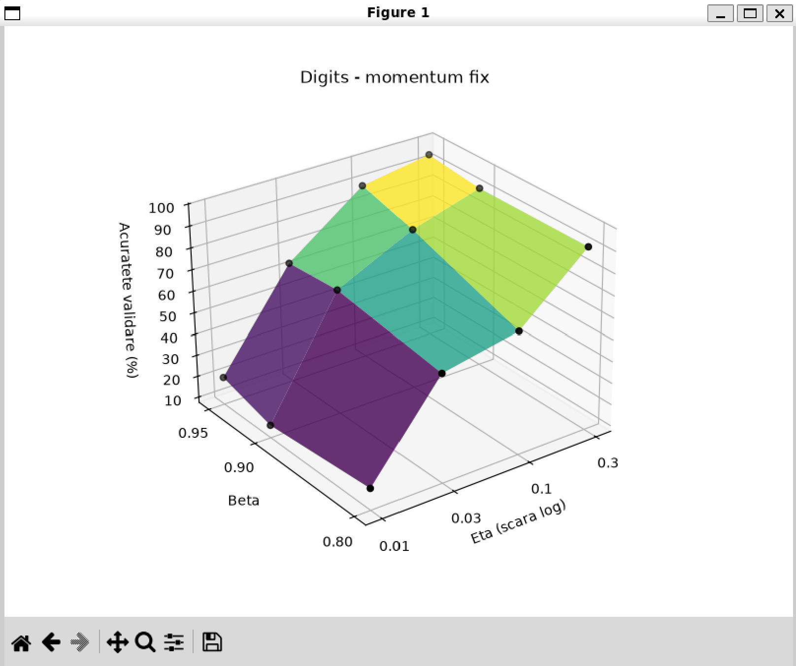

# DNO - Dual-Network Optimizer - C++

Hello! I implemented a C++ project where one neural network learns to recognize handwritten digits and a second network, called Tilda, learns to adjust its training steps. I put the reusable operations in `Functii.h` to make the training code easier to follow. The project covers preprocessing the MNIST dataset, implementing the base network and its gradients, training Tilda to choose the learning rate and momentum, and testing the trained model on unseen images. The matrix operations and backpropagation are written directly in C++.

## Question

How well can Tilda adapt the classifier's learning rate and momentum across datasets using a single controller configuration?

The goal is to reduce dataset-specific tuning. I set the initial learning rate and momentum and the controller's own learning rate before training. During training, Tilda produces a learning rate and momentum for each mini-batch, then updates its weights using the loss after the classifier's step. The same-batch loss gives Tilda a local training objective.

## Demo

I used `TestModel.py` to train a small PyTorch classifier on scikit-learn Digits with 12 fixed learning-rate and momentum pairs. Each point shows validation accuracy after five epochs. The runs use the same data split, initial weights, and batch order. The surface connects the measured points.



The sweep illustrates how sensitive training can be to the choice of learning rate and momentum. In the C++ project, Tilda chooses both values automatically at each mini-batch using feedback from the training loss.

## Compilation

### With Makefile

To compile the project using the Makefile on Linux or WSL, run `make` in the terminal. To compile and start the program, run `make run`. To remove the compiled executable, run `make clean`. Run these commands from the project folder, with the MNIST files already extracted there.

```bash
make run
```

### Without Makefile

With g++ on Linux or WSL, compile and run the project with the following commands.

```bash
g++ -std=c++17 -O2 TildaModel.cpp -o tilda
./tilda
```

On Windows, run these commands in PowerShell with g++ installed.

```powershell
g++ -std=c++17 -O2 TildaModel.cpp -o tilda.exe
.\tilda.exe
```

### Required Dependencies and MNIST Data

To compile and run the project, you need g++ with C++17 support and `Functii.h` beside `TildaModel.cpp`. You also need `make` if you use the Makefile. Download and extract the four archives from the [MNIST mirror](https://github.com/cvdfoundation/mnist).

Place the extracted data in the project folder and use these filenames.

```text
train-images.idx3-ubyte
train-labels.idx1-ubyte
t10k-images.idx3-ubyte
t10k-labels.idx1-ubyte
```

## How It Works

### Structures Used

The networks use matrices represented by vectors of vectors. Each network has two weight matrices and two bias vectors. Separate matrices store the momentum velocities, while vectors keep the loss and the commands produced by Tilda during training.

```cpp
using Matrice = vector<vector<float>>;

// Parameters of the base network!
Matrice W1, b1, W2, b2;

// Parameters of the Tilda network!
Matrice Wt1, bt1, Wt2, bt2;

// Momentum velocities for the base network!
Matrice vW1, vb1, vW2, vb2;

// Training history!
vector<double> vJ;
vector<float> vEta, vBeta;
```

### Step 1 - Reading and preprocessing MNIST

For the first step, we read the images and labels directly from the binary IDX files. Each image contains 28 by 28 pixels, which become a row of 784 values in `X_train`. We divide each pixel by 255 to bring its value into the interval [0, 1]. The labels are stored in `Y_train` as rows with ten values, where the correct digit has value 1 and the others have value 0. The program uses 60,000 images for training and reads the separate 10,000 test images after training is finished.

### Step 2 - Implementing the base network

For the second step, we build a network with 784 inputs, a hidden layer of 64 sigmoid neurons and a softmax output layer with ten outputs, one for each digit. During the forward pass, the network computes the probability of each digit. We calculate the cross-entropy loss and derive the gradients for `W1`, `b1`, `W2` and `b2` using backpropagation. These calculations are written separately in the code so that each line can be followed as a mathematical operation. Training uses batches of 64 images.

### Step 3 - Training the Tilda network

For the third step, we add Tilda, a smaller network with five inputs, eight sigmoid neurons and two outputs. Its inputs describe the current loss, gradient norm, previous learning rate, previous momentum and training progress. Tilda produces a positive learning rate `eta` using softplus and a momentum coefficient `beta` using sigmoid. We then update each parameter of the base network with this rule.

```text
v = beta * v + gradient
parameter = parameter - eta * v
```

After the update, we calculate the base network's loss and gradients again on the same batch. These gradients tell us how the loss changes with respect to `eta` and `beta`, allowing us to train Tilda through its own backpropagation with `alpha = 0.001`. This is a local objective based on one training step. I chose two networks so that the base network handles classification and Tilda handles training control. Tilda adds calculations during training, while predictions use only the base network.

### Step 4 - Testing the trained model

For the final step, we pass the 10,000 test images through the trained base network, choose the digit with the highest output probability and compare it with the correct label. The classifier uses the trained weights for this test pass.

## Results

On MNIST, the recorded five-epoch run reached 92.95% test accuracy with Tilda, 92.93% with fixed momentum (eta = 0.01, beta = 0.9), and 85.57% with SGD (eta = 0.01). The runs used the same initial weights and batch order, with initialization seed 123 and shuffle seed 456.

## Next Experiment

Run the same C++ classifier on MNIST and Fashion-MNIST with the same starting settings for Tilda. Fashion-MNIST has the same 28 x 28 image size, ten classes, and IDX format. It provides a second classification task with the current architecture. [Fashion-MNIST dataset](https://github.com/zalandoresearch/fashion-mnist#get-the-data)

Use a validation split on each dataset to choose the fixed-momentum reference. Compare validation loss over training and count the complete training runs used to select settings, including any runs used to calibrate Tilda. Track total training time as well, since Tilda computes a second gradient after each classifier update.

## Explore the Grid in PyTorch

`TestModel.py` runs a separate fixed-momentum sweep on the original 8 x 8 Digits images. It chooses the pair on validation, evaluates it on the test set, and saves `acuratete_3d.png`.

```bash
python -m pip install torch numpy scikit-learn matplotlib
python TestModel.py
```

## Conclusion

I wanted to see whether a small neural network could learn how to train another one. After I set the starting values, Tilda learns to adjust the classifier's learning rate and momentum as training progresses. I use accuracy to see how well those choices work. The question is: How well would this approach work in other projects?
